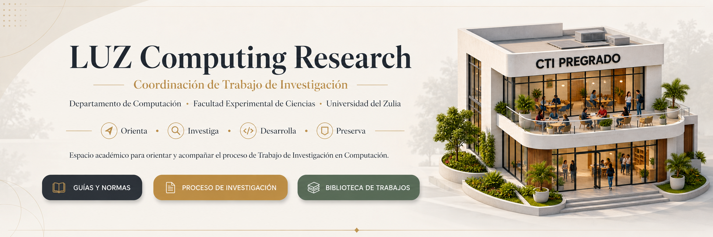

<p align="center">
  
</p>


<!--

<div align="center">

# LUZ Computing Research

### Coordinación de Trabajo de Investigación

**Departamento de Computación · Facultad Experimental de Ciencias · Universidad del Zulia**

### Orienta · Investiga · Desarrolla · Preserva

Espacio académico para orientar y acompañar el proceso de **Trabajo de Investigación en Computación**, desde la formulación del Proyecto de Trabajo de Investigación hasta la defensa, cierre y futura preservación responsable de sus resultados.
-->
<div align="center">
<p align="center">
  <a href="https://github.com/LUZ-Computing-Research/recursos-proyectos">
    
  </a>
  &nbsp;
  <a href="#ruta-del-trabajo-de-investigación">
    
  </a>
  &nbsp;
  <a href="#biblioteca-digital">
    
  </a>
</p>

</div>

---

## Coordinación de Trabajo de Investigación

**LUZ Computing Research** representa el espacio digital de apoyo de la **Coordinación de Trabajo de Investigación del área de Computación de la Facultad Experimental de Ciencias de la Universidad del Zulia**.

Su propósito es facilitar el acceso organizado a información, recursos académicos, documentos institucionales y orientaciones relacionadas con el proceso de Trabajo de Investigación de pregrado.

La Coordinación:

* orienta sobre el proceso institucional;
* facilita el acceso a reglamentos, formatos y recursos;
* organiza información relacionada con las distintas etapas;
* apoya el seguimiento documental del proceso;
* promueve buenas prácticas académicas;
* prepara la futura preservación de trabajos culminados y autorizados.

> **La Coordinación no sustituye al tutor académico del estudiante ni realiza automáticamente la evaluación de su Trabajo de Investigación.**

---

## Ruta del Trabajo de Investigación

El proceso académico se organiza conceptualmente en **dos grandes fases**:

```text
INICIO
  │
  ▼
ORIENTACIÓN
  │
  ▼
FASE 1
PROYECTO DE TRABAJO DE INVESTIGACIÓN · PTI
  │
  ▼
REVISIÓN Y APROBACIÓN DEL PROYECTO
  │
  ▼
FASE 2
TRABAJO DE INVESTIGACIÓN · TI
  │
  ▼
TRABAJO FINAL
  │
  ▼
DEFENSA
  │
  ▼
CORRECCIONES FINALES
  │
  ▼
CIERRE
  │
  ▼
PRESERVACIÓN
```

Los requisitos, responsables, documentos y procedimientos específicos de cada etapa deberán corresponder siempre a la **normativa institucional vigente**.

---

## Fase 1 · Proyecto de Trabajo de Investigación

El **Proyecto de Trabajo de Investigación (PTI)** constituye la primera gran fase del proceso.

En ella se desarrolla la formulación inicial de la investigación y se organiza la documentación requerida para presentar el proyecto conforme a las disposiciones institucionales aplicables.

### Recursos disponibles

Actualmente la organización dispone del repositorio:

### [📘 recursos-proyectos](https://github.com/LUZ-Computing-Research/recursos-proyectos)

Allí se centralizan recursos relacionados con el PTI, incluyendo:

* reglamentos;
* formatos;
* documentos de apoyo;
* plantillas;
* ejemplos autorizados;
* recursos para la preparación del proyecto.

> Utiliza siempre la versión más reciente de los documentos publicados y verifica la normativa institucional aplicable.

---

## Fase 2 · Trabajo de Investigación

Una vez culminada y aprobada la fase correspondiente al Proyecto de Trabajo de Investigación, comienza el desarrollo del **Trabajo de Investigación (TI)**.

Esta fase comprende el desarrollo de la investigación hasta la preparación del trabajo final, su defensa y las correcciones que correspondan.

La documentación institucional específica de esta fase será incorporada progresivamente a la organización.

**Repositorio de recursos para Trabajo de Investigación: en preparación.**

---

## Tutor y responsabilidades

El proceso involucra distintos actores académicos.

| Actor            | Rol general                                                                                                   |
| ---------------- | ------------------------------------------------------------------------------------------------------------- |
| **Estudiante**   | Desarrolla su Trabajo de Investigación y cumple los requisitos académicos e institucionales correspondientes. |
| **Tutor**        | Acompaña académicamente al estudiante durante el desarrollo de su investigación.                              |
| **Coordinación** | Orienta y gestiona los aspectos institucionales del proceso que le correspondan.                              |
| **Jurado**       | Participa en la evaluación cuando corresponda, de acuerdo con la normativa institucional vigente.             |

Las responsabilidades específicas deberán interpretarse siempre conforme a los reglamentos y procedimientos oficiales aplicables.

---

## Guías y normas

La organización busca facilitar progresivamente el acceso a documentación relacionada con:

* requisitos;
* estructura del Proyecto de Trabajo de Investigación;
* estructura del Trabajo de Investigación final;
* normas de presentación;
* cronogramas e hitos;
* formatos institucionales;
* defensa;
* correcciones;
* entrega final;
* preservación;
* productos de software asociados.

### Documentación disponible actualmente

[**Consultar recursos del Proyecto de Trabajo de Investigación →**](https://github.com/LUZ-Computing-Research/recursos-proyectos)

La documentación correspondiente al Trabajo de Investigación final será incorporada posteriormente.

---

## Metodología

Los Trabajos de Investigación pueden utilizar diferentes enfoques metodológicos de acuerdo con:

* la naturaleza del problema;
* los objetivos de investigación;
* el área de Computación involucrada;
* las características del proyecto;
* las orientaciones del tutor;
* la normativa académica aplicable.

Los recursos metodológicos publicados en esta organización tendrán carácter de **orientación académica** y no sustituirán las disposiciones institucionales ni las indicaciones específicas del tutor.

---

## Formatos y plantillas

Los formatos institucionales y plantillas disponibles deben utilizarse de acuerdo con su finalidad y vigencia.

Para la fase de Proyecto de Trabajo de Investigación pueden consultarse los recursos existentes en:

[**Formatos y recursos PTI →**](https://github.com/LUZ-Computing-Research/recursos-proyectos)

Los documentos correspondientes a fases posteriores serán incorporados progresivamente.

---

## Hitos y entregables

La organización permitirá documentar progresivamente los principales hitos del proceso:

**Orientación**
↓
**Proyecto de Trabajo de Investigación**
↓
**Aprobación del proyecto**
↓
**Desarrollo del Trabajo de Investigación**
↓
**Trabajo Final**
↓
**Defensa**
↓
**Correcciones**
↓
**Cierre**

Los requisitos y procedimientos específicos de cada hito deberán corresponder a la normativa institucional vigente.

---

## Defensa

La defensa constituye uno de los hitos finales del Trabajo de Investigación.

La información relacionada con:

* requisitos;
* procedimientos;
* documentos;
* presentación;
* jurado;
* correcciones;
* entrega definitiva;

será publicada únicamente con base en la documentación institucional correspondiente.

---

## Productos de software

Algunos Trabajos de Investigación en Computación pueden producir **software, prototipos, modelos, conjuntos de datos u otros artefactos digitales**.

Cuando corresponda, estos productos podrán preservarse después de completar el proceso académico y realizar las revisiones necesarias.

Antes de su publicación deberán considerarse aspectos como:

* autorización;
* información sensible;
* datos personales;
* credenciales o secretos;
* documentación;
* dependencias;
* condiciones de reutilización;
* licencia, cuando corresponda.

> Los repositorios utilizados durante el desarrollo académico **no se publican automáticamente**.

---

## Biblioteca digital

Uno de los objetivos futuros de **LUZ Computing Research** es construir progresivamente una biblioteca digital de Trabajos de Investigación defendidos.

Esta biblioteca permitirá conservar la memoria académica y facilitar la consulta responsable por futuras cohortes.

### Una futura ficha de trabajo podrá incluir

* título;
* autoría autorizada;
* tutor;
* año o período académico;
* área;
* resumen;
* palabras clave;
* metodología;
* tecnologías utilizadas;
* fecha de defensa;
* documento autorizado;
* producto de software, cuando exista;
* repositorio público, cuando exista;
* condiciones de consulta;
* licencia, cuando corresponda.

### Principio de preservación

```text
TRABAJO EN DESARROLLO
        │
        ▼
DEFENSA
        │
        ▼
CORRECCIONES
        │
        ▼
CIERRE
        │
        ▼
REVISIÓN PARA PRESERVACIÓN
        │
        ▼
MATERIAL AUTORIZADO
        │
        ▼
BIBLIOTECA DIGITAL
```

**Un trabajo defendido no se convierte automáticamente en un trabajo públicamente disponible.**

---

## Trabajos defendidos

Este espacio será habilitado progresivamente para trabajos que:

* hayan culminado el proceso institucional;
* puedan ser preservados responsablemente;
* cuenten con las autorizaciones correspondientes;
* no contengan información que deba mantenerse privada o restringida.

No se publicarán trabajos ficticios ni registros académicos sin respaldo documental.

---

## Integridad académica, autoría y citación

La consulta de trabajos anteriores tiene como finalidad apoyar el aprendizaje y la investigación.

Los materiales preservados deberán utilizarse respetando:

**Consulta → Citación → Atribución → Reutilización responsable**

La biblioteca deberá promover buenas prácticas relacionadas con:

* integridad académica;
* prevención del plagio;
* reconocimiento de autoría;
* citación;
* reutilización responsable de documentos;
* uso responsable de software y otros artefactos académicos.

Consultar un trabajo anterior **no autoriza su copia ni su reutilización sin atribución**.

---

## Privacidad

Durante el desarrollo del proceso académico no deberán publicarse innecesariamente:

* borradores;
* calificaciones;
* observaciones privadas;
* direcciones de correo;
* datos personales;
* repositorios privados;
* credenciales;
* información sensible.

La futura biblioteca pública incorporará únicamente materiales que hayan culminado el proceso correspondiente y puedan preservarse responsablemente.

---

## Preguntas frecuentes

Esta sección será ampliada progresivamente con preguntas relacionadas con:

* inicio del proceso;
* Proyecto de Trabajo de Investigación;
* tutor;
* documentos;
* Trabajo de Investigación;
* defensa;
* correcciones;
* entrega final;
* preservación.

Cuando una respuesta dependa de una norma institucional, se enlazará la fuente correspondiente.

---

## Recursos

### Disponibles

* [**Recursos para Proyectos de Trabajo de Investigación (PTI)**](https://github.com/LUZ-Computing-Research/recursos-proyectos)

### Próximamente

* Recursos para Trabajo de Investigación (TI).
* Guías de orientación.
* Recursos metodológicos.
* Biblioteca de trabajos defendidos.
* Catálogo de productos de software asociados.

---

## Documentación

La documentación de **LUZ Computing Research** se desarrollará bajo tres categorías claramente diferenciadas:

| Tipo                            | Función                                                                                |
| ------------------------------- | -------------------------------------------------------------------------------------- |
| **Documentación institucional** | Reglamentos, normas, requisitos, procedimientos y formatos oficiales.                  |
| **Guías de orientación**        | Material elaborado para facilitar la comprensión del proceso institucional.            |
| **Recursos académicos**         | Material complementario sobre investigación, metodología, citación y buenas prácticas. |

Las guías y recursos académicos **no sustituyen la normativa institucional vigente**.

---

<div align="center">

### LUZ Computing Research

**Coordinación de Trabajo de Investigación**

Computación · Facultad Experimental de Ciencias · Universidad del Zulia

**Orienta · Investiga · Desarrolla · Preserva**

</div>
